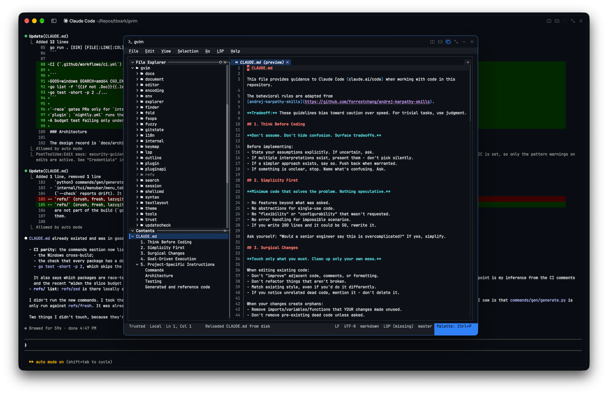

# gvim

A fast, keyboard-driven terminal code viewer and editor written in pure Go.

`gvim` is built for reading code, navigating large projects, and inspecting git diffs quickly and
safely. It ships as a single static binary with no runtime dependencies.



## Highlights

- **Code viewer with read-only protection**: `gvim -R` locks every buffer against accidental
  edits, pastes, and saves. Syntax highlighting for 30+ languages, code folding, sticky scroll,
  and windowed streaming for 100+ MiB files.
- **LSP navigation**: definition, implementation, references with preview, document and workspace
  symbols, call hierarchy, hover, diagnostics, and a cross-file back/forward history
  (`Alt+Left` / `Alt+Right`).
- **Git and diff**: side-by-side file comparison (`gvim --diff a b`), gutter change markers,
  inline blame, commit log, and a review-diff mode for staged, unstaged, and untracked changes.
- **Fast search**: fuzzy Quick Open (`Ctrl+P`, with `:line`, `#buffers`, `>commands`), project-wide
  Live Grep (`Alt+/`), in-file find and replace, and Flash Jump.
- **Markdown**: rendered view, source view, or a synchronized dual view, plus an outline in the
  sidebar.
- **Pure Go, cross-platform**: macOS, Linux, and Windows, with `default`, `vscode`, `emacs`,
  `macos`, and `macos-gui` keymaps.

Some features (Git Log, Review Diff, Merge conflict resolution, Flash Jump, and the LSP symbol
and call-hierarchy commands) are bundled plugins that are off by default. See
[`docs/plugins/bundled.md`](docs/plugins/bundled.md) for how to enable them.

## Install

Requires Go 1.27.3 or later.

```sh
go install github.com/tbxark/gvim@latest
```

Or build from source (`CGO_ENABLED=0` gives a pure-Go static binary):

```sh
git clone https://github.com/tbxark/gvim.git
cd gvim
CGO_ENABLED=0 go build -o gvim .
```

## Usage

```sh
gvim .                          # Open current directory
gvim -R .                       # Read-only code-viewer mode
gvim -R main.go:42:10           # Open file at line 42, column 10
gvim --diff fileA.go fileB.go   # Compare two files side by side
git show HEAD | gvim -          # View piped stdin in a scratch buffer
```

Run `gvim --help` for every flag; the full list is in [`docs/usage.md`](docs/usage.md).

## Essential keys

*(`default` keymap. Press `Ctrl+P` then `>` for the command palette.)*

| Key | Action |
|---|---|
| `Ctrl+P` | Quick Open: files, `>commands`, `:line`, `#buffers` |
| `Ctrl+F` / `Alt+/` | Find in file / Live Grep across the project |
| `F12` / `Shift+F12` | Go to definition / Find references |
| `Alt+Left` / `Alt+Right` | Navigate back / forward |
| `Alt+Z` | Toggle fold at cursor |
| `Ctrl+\` / `Alt+\` | Split right / below |
| `` Alt+` `` | Open a terminal in the dock |

The complete cheat sheet (LSP, Git, mouse, pager mode, Markdown modes) is in
[`docs/usage.md`](docs/usage.md); presets and rebinding are in
[`docs/keybindings.md`](docs/keybindings.md).

## Documentation

- [`docs/usage.md`](docs/usage.md): command-line options and the keybinding cheat sheet
- [`docs/keybindings.md`](docs/keybindings.md): keymap presets and rebinding
- [`docs/settings.md`](docs/settings.md): configuration schema and live settings
- [`docs/themes.md`](docs/themes.md): theme specification and customization
- [`docs/plugins/README.md`](docs/plugins/README.md): plugin API and bundled plugins
- [`docs/markdown.md`](docs/markdown.md): Markdown page view and dual scroll sync
- [`docs/terminal.md`](docs/terminal.md): terminal dock and scrollback model
- [`docs/architecture.md`](docs/architecture.md): package boundaries and import rules
- [`docs/ui.md`](docs/ui.md): UI styling, geometry, overlays
- [`docs/parity.md`](docs/parity.md): Fresh parity matrix and open gaps

## Thanks

- [Fresh](https://github.com/sinelaw/fresh): the terminal editor whose feature set and design
  `gvim` measures itself against.
  
## License

**gvim** is released under the MIT license. [See LICENSE](LICENSE) for details.
